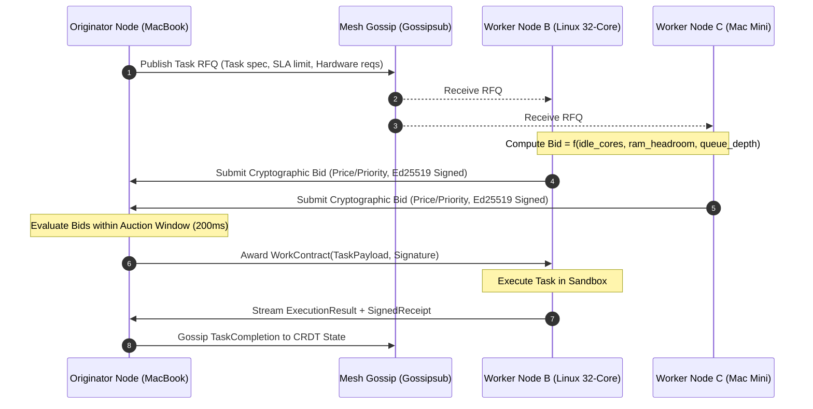

# 🍄 MYCEL: Architecture Specification & RFC v1.0
> **The Sovereign, Zero-Cloud P2P Mesh Network & Compute Exchange for Autonomous Edge Agents**

---

## 1. Executive Summary

Autonomous AI agents (such as Claude Code, Google Antigravity, and Cursor) are currently tethered to centralized cloud infrastructure: centralized task coordinators, cloud databases (Postgres, Redis), and remote API endpoints. When network connectivity drops, API rate limits hit, or cloud orchestrators fail, multi-agent workflows collapse.

**Mycel** is an open-source, local-first, peer-to-peer mesh network and decentralized compute exchange written in **Rust**. Built on `libp2p` and Conflict-Free Replicated Data Types (CRDTs), Mycel enables heterogeneous edge devices (MacBooks, Linux workstations, edge servers, Raspberry Pis) to autonomously discover one another over local Wi-Fi / Bluetooth / LAN, establish cryptographically verified peer identities, and form an unkillable, partition-tolerant hivemind.

Through the **Spore Reverse-Auction Protocol**, agents dynamically delegate compute-intensive sub-tasks (test execution, code compilation, sandbox verification, local SLM inference) to neighboring idle nodes in the mesh with microsecond scheduling overhead.

---

## 2. Core Architectural Principles

1. **Zero-Cloud Dependency:** Complete operation without external servers, centralized relays, or third-party orchestrators.
2. **Cryptographic Provenance:** Every node identity, task dispatch, bid, and execution result is signed with Ed25519 keys.
3. **Partition Tolerance & Air-Gap Resilience:** If WAN connectivity terminates, the local mesh continues operating; state divergence is deterministically resolved upon reconnection using Delta-CRDTs.
4. **Heterogeneous Hardware Tiering:** Nodes broadcast hardware profiles (Metal GPU, CUDA, CPU core count, RAM headroom, local SLMs) so tasks are automatically routed to optimal hardware.
5. **Zero-Overhead Memory Footprint:** Built natively in Rust for sub-10ms peer discovery, <1ms gossip routing, and minimal memory overhead.

---

## 3. High-Level System Architecture

```text
               +-------------------------------------------------------+
               |                  Autonomous AI Agent                  |
               |       (Claude Code / Google Antigravity / CLI)        |
               +---------------------------+---------------------------+
                                           | IPC / Stdio / API
                                           v
               +-------------------------------------------------------+
               |                     Mycel Node                        |
               |                                                       |
               |  +--------------------+       +--------------------+  |
               |  |  Identity & Crypto |       |   Spore Auction    |  |
               |  |  (Ed25519 Keypair) |       |  (RFQ / Bids / SLA)|  |
               |  +---------+----------+       +---------+----------+  |
               |            |                            |             |
               |            +-------------+--------------+             |
               |                          |                            |
               |  +-----------------------v-------------------------+  |
               |  |              Distributed CRDT Memory            |  |
               |  |         (Active Swarm State & Task Log)         |  |
               |  +-----------------------+-------------------------+  |
               |                          |                            |
               |  +-----------------------v-------------------------+  |
               |  |                libp2p Swarm Layer               |  |
               |  |  [mDNS Discovery]  [QUIC Transport]  [Gossipsub]|  |
               |  +-----------------------+-------------------------+  |
               +--------------------------+----------------------------+
                                          |
                      +-------------------+-------------------+
                      | Encrypted P2P Wire (Noise Protocol)   |
                      v                                       v
         +-------------------------+             +-------------------------+
         |     Neighbor Node A     |             |     Neighbor Node B     |
         | (MacBook M3 Max / Metal)|             | (Linux Workstation / CPU|
         +-------------------------+             +-------------------------+
```

---

## 4. The "Spore" Reverse-Auction Protocol

The **Spore Protocol** governs how work is assigned across the mesh without a master coordinator:



---

## 5. Crate Architecture (Rust Workspace)

- **`mycel-proto`**: Core serializable types, protocol buffers/bincode, Spore RFQ, Bid, WorkContract, SignedReceipt, NodeCapability schemas.
- **`mycel-crypto`**: Ed25519 keypair generation, PeerId derivation, message signing and verification, SHA256 integrity checks.
- **`mycel-net`**: libp2p network transport, mDNS discovery, QUIC, Noise encryption, Yamux multiplexing, and Gossipsub pub/sub topics.
- **`mycel-auction`**: State machine for reverse-auction compute market (Auctioneer and Bidder roles).
- **`mycel-crdt`**: In-memory distributed state store with logical clocks for cluster membership and task history.
- **`mycel-node`**: Core daemon uniting networking, task dispatching, sandboxed execution, and event bus.
- **`mycel-cli`**: Command-line interface and interactive Ratatui TUI dashboard.

---

## 6. Milestone Plan

1. **Phase 1: Foundation & Workspace**: Crate structure, proto wire schemas, and crypto identities.
2. **Phase 2: P2P Swarm & Discovery**: libp2p runtime with zero-config mDNS and Gossipsub routing.
3. **Phase 3: Spore Auction Engine**: RFQ broadcast, distributed bidding, award consensus, and execution receipts.
4. **Phase 4: CRDT Distributed State**: Partition-tolerant cluster memory and delta sync.
5. **Phase 5: CLI & Node Daemon**: Interactive CLI commands and multi-node terminal runner.
6. **Phase 6: Multi-Node Terminal Demo**: Animated simulation demonstrating live peer discovery, task auction, and execution.
