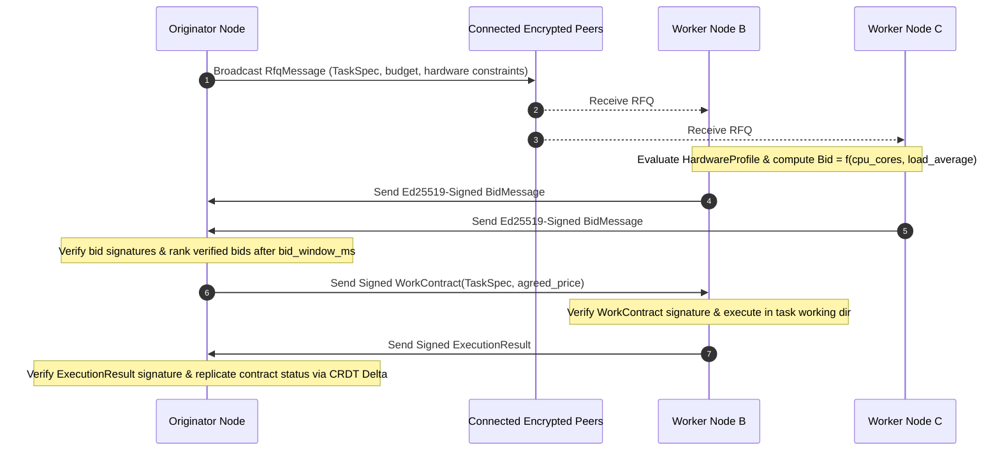

# 🍄 MYCEL: Architecture Specification & RFC v1.0
> **Sovereign, Zero-Cloud P2P Mesh Network & Compute Exchange for Autonomous Edge Agents**

---

## 1. Executive Summary

Autonomous AI agents often depend on centralized task coordinators, cloud databases, and remote API endpoints. When WAN connectivity drops or centralized orchestrators are unavailable, multi-agent workflows stall.

**Mycel** is an open-source, local-first, peer-to-peer mesh network and decentralized compute exchange written in **Rust**. Mycel enables edge machines on a local network (macOS and Linux hosts) to discover one another via UDP beacons, establish Ed25519-authenticated **X25519 + ChaCha20-Poly1305 AEAD** encrypted TCP links, replicate state with Last-Write-Wins **Delta-CRDTs**, and delegate work via the **Spore Reverse-Auction Protocol**.

---

## 2. Core Architectural Principles

1. **Zero-Cloud Dependency:** Operates directly over LAN or loopback TCP/UDP without external relays or central coordinators.
2. **Cryptographic Provenance & Transport Confidentiality:** Every peer identity is backed by an Ed25519 keypair (`12D3KooW...` derived from the public key). Handshakes exchange signed ephemeral X25519 keys, and all post-handshake TCP frames are encrypted and authenticated with ChaCha20-Poly1305 AEAD and monotonic 96-bit sequence nonces.
3. **Partition-Tolerant State Convergence:** State updates write to a local LWW Delta-CRDT store with Lamport logical clocks (`CrdtStore`), broadcast `MeshMessage::Delta` across connected peers, and exchange `MeshMessage::CrdtSnapshot` when peers connect.
4. **Live Hardware-Aware Routing:** Nodes detect host CPU cores, physical RAM (`sysctl hw.memsize` on macOS, `/proc/meminfo` on Linux), 1-minute load average (`libc::getloadavg`), Metal/CUDA availability, and configured local SLMs (`MYCEL_SLM_MODEL`).
5. **Real Isolated Execution:** `TaskExecutor` runs `BashScript`, `TestSuite`, `RustCompilation`, and `SlmInference` (against a configured local HTTP endpoint such as Ollama) inside per-task working directories.

---

## 3. High-Level System Architecture

```text
               +-------------------------------------------------------+
               |               CLI / Autonomous Agent                  |
               |         (mycel dispatch / demo / tui / start)         |
               +---------------------------+---------------------------+
                                           |
                                           v
               +-------------------------------------------------------+
               |                     NodeDaemon                        |
               |                                                       |
               |  +--------------------+       +--------------------+  |
               |  |  Identity & Crypto |       |   Spore Auction    |  |
               |  |  Ed25519 + X25519  |       |  (RFQ / Bids / SLA)|  |
               |  +---------+----------+       +---------+----------+  |
               |            |                            |             |
               |            +-------------+--------------+             |
               |                          |                            |
               |  +-----------------------v-------------------------+  |
               |  |              Delta-CRDT Store                   |  |
               |  |    (Lamport Clock State & Peer Heartbeats)      |  |
               |  +-----------------------+-------------------------+  |
               |                          |                            |
               |  +-----------------------v-------------------------+  |
               |  |                 MeshNetwork                     |  |
               |  |  [UDP Multicast/Broadcast]  [AEAD TCP Framing]  |  |
               |  +-----------------------+-------------------------+  |
               +--------------------------+----------------------------+
                                          |
                      +-------------------+-------------------+
                      | ChaCha20-Poly1305 AEAD Encrypted TCP  |
                      v                                       v
         +-------------------------+             +-------------------------+
         |     Neighbor Node A     |             |     Neighbor Node B     |
         |  (Coordinator / Worker) |             |        (Worker)         |
         +-------------------------+             +-------------------------+
```

---

## 4. The "Spore" Reverse-Auction Protocol

The **Spore Protocol** assigns compute tasks across connected peers without a static master scheduler:



---

## 5. Crate Architecture (Rust Workspace)

- **`mycel-proto`**: Serializable wire schemas, `HardwareProfile::detect()`, `SignedHandshake`, `PeerDiscoveryBeacon`, `RfqMessage`, `BidMessage`, `WorkContract`, `ExecutionResult`, and `CrdtDelta`.
- **`mycel-crypto`**: Ed25519 `NodeIdentity` signing/verification, peer-ID binding verification, and `ring` X25519 + HKDF-SHA256 + ChaCha20-Poly1305 AEAD ciphers.
- **`mycel-net`**: Length-delimited encrypted TCP transport, signed X25519 handshakes, and UDP LAN peer auto-discovery (`SO_REUSEADDR`/`SO_REUSEPORT`).
- **`mycel-auction`**: Reverse-auction state machine with Ed25519 signature verification on bids, contracts, and execution results.
- **`mycel-crdt`**: In-memory LWW Delta-CRDT store with Lamport logical clocks and snapshot export.
- **`mycel-node`**: `NodeDaemon` event routing, CRDT delta/snapshot replication, and `TaskExecutor`.
- **`mycel-cli`**: CLI (`init`, `start`, `dispatch`, `demo`, `tui`) and Ratatui live cluster dashboard.
