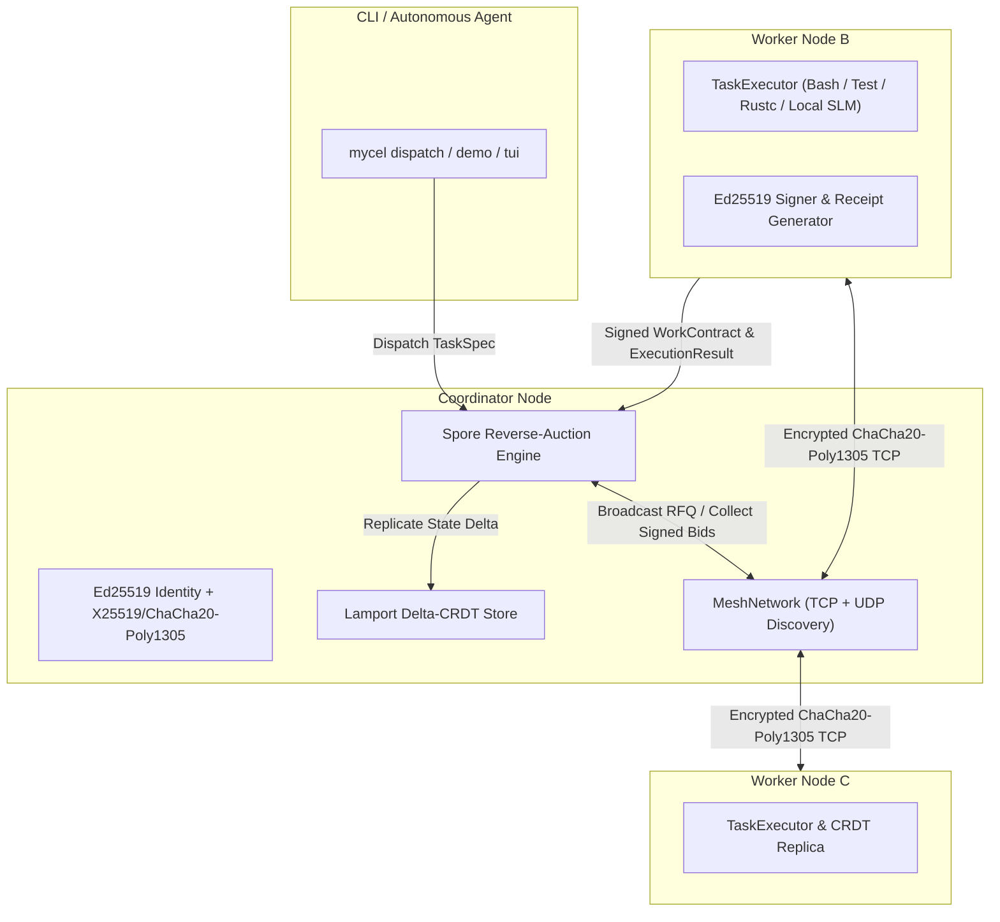

# 🍄 MYCEL

```text
  __  ____   ______ _____ _      
 |  \/  \ \ / / ___| ____| |     
 | |\/| |\ V / |   |  _| | |     
 | |  | | | || |___| |___| |___  
 |_|  |_| |_| \____|_____|_____| 
```

> **Sovereign, Zero-Cloud P2P Mesh Network & Compute Exchange for Autonomous Edge Agents**  
> *Zero Servers. Zero Cloud APIs. Zero Centralized Orchestration. 100% Peer-to-Peer.*

[](https://github.com/khalidfarooq/mycel/actions/workflows/ci.yml)
[](#)
[](#)
[](#)

---

## 🎬 Terminal Demo: Live 3-Node Mesh, Encrypted Auctions & CRDT Sync


---

## ⚡ Key Capabilities

- 🌐 **UDP LAN Peer Auto-Discovery:** Nodes broadcast Ed25519-signed `PeerDiscoveryBeacon` packets over UDP multicast/broadcast (`SO_REUSEADDR` / `SO_REUSEPORT`) and automatically connect with deterministic peer-ID tie-breaking.
- 🔒 **Authenticated Encrypted TCP Transport:** Every peer link performs an Ed25519-authenticated ephemeral **X25519** key exchange with **HKDF-SHA256** key derivation and **ChaCha20-Poly1305 AEAD** framing using monotonic 96-bit sequence nonces.
- ⚡ **The Spore Reverse-Auction Protocol:** Tasks are auctioned to connected peers evaluated against live OS hardware metrics (CPU cores, system RAM, 1m load average, Metal/CUDA availability). Bids, contracts, and execution receipts are Ed25519-signed and verified.
- 🧬 **Conflict-Free Replicated State:** Last-Write-Wins Delta-CRDT memory (`CrdtStore`) with Lamport logical clocks replicates state deltas across peers and syncs full snapshots on peer connection.
- 🛠️ **Real Isolated Task Execution:** Executes `BashScript`, `TestSuite`, `RustCompilation` (`rustc`/`cargo`), and `SlmInference` (local Ollama / OpenAI-compatible HTTP endpoint) in per-task working directories.

---

## 🏗️ Architecture



---

## 📦 Workspace Crates

- **`mycel-proto`:** Wire message schemas (`MeshMessage`, `SignedHandshake`, `PeerDiscoveryBeacon`, `RfqMessage`, `BidMessage`, `WorkContract`, `ExecutionResult`, `CrdtDelta`) and OS-level `HardwareProfile::detect()`.
- **`mycel-crypto`:** Ed25519 node identities (`ed25519-dalek`), deterministic peer ID verification, and `ring` X25519 + HKDF-SHA256 + ChaCha20-Poly1305 AEAD session ciphers.
- **`mycel-net`:** Encrypted length-delimited TCP framing, mutual signed handshakes, UDP multicast/broadcast peer discovery, and connection deduplication.
- **`mycel-auction`:** Spore reverse-auction state machine with Ed25519 signature verification on bids, contracts, and execution results.
- **`mycel-crdt`:** In-memory LWW Delta-CRDT store with Lamport logical clocks and snapshot export.
- **`mycel-node`:** `NodeDaemon` event loop, automatic CRDT delta/snapshot sync, and isolated `TaskExecutor`.
- **`mycel-cli`:** `mycel` CLI (`init`, `start`, `dispatch`, `demo`, `tui`).

---

## 🚀 Quickstart

### 1. Build
```bash
git clone https://github.com/khalidfarooq/mycel.git
cd mycel
cargo build --release
```

### 2. Initialize Node Identity & Inspect Host Hardware
```bash
./target/release/mycel init
```

### 3. Run the Live 3-Node Mesh Demo
```bash
cargo run -p mycel-cli -- demo
```

### 4. Launch the Real-Time Interactive TUI Dashboard
```bash
cargo run -p mycel-cli -- tui
```

### 5. Start a Node & Dispatch a Task
Terminal 1 (Worker):
```bash
./target/release/mycel start --name worker-1 --port 8765
```
Terminal 2 (Dispatcher via UDP auto-discovery or `--peers`):
```bash
./target/release/mycel dispatch --cmd "cargo --version" --kind bash --budget 100
# Or connect directly:
./target/release/mycel dispatch --peers 127.0.0.1:8765 --cmd "echo hello" --kind bash
```

---

## 🧪 Testing

```bash
cargo test --workspace
```
