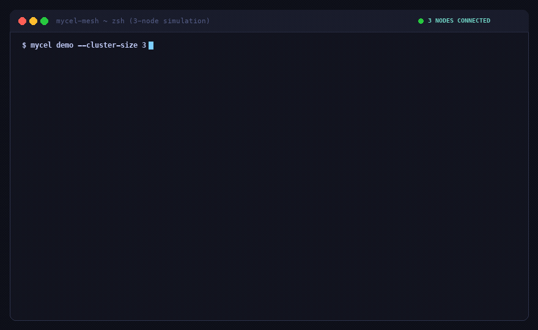
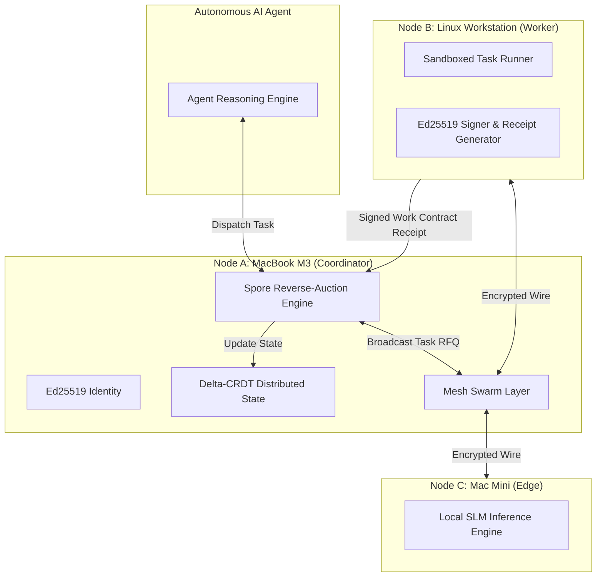

# 🍄 MYCEL

```text
  __  ____   ______ _____ _      
 |  \/  \ \ / / ___| ____| |     
 | |\/| |\ V / |   |  _| | |     
 | |  | | | || |___| |___| |___  
 |_|  |_| |_| \____|_____|_____| 
```

> **The Sovereign, Zero-Cloud P2P Mesh Network & Compute Exchange for Autonomous Edge Agents**  
> *Zero Servers. Zero Cloud APIs. Zero Centralized Orchestration. 100% Peer-to-Peer.*

[](#)
[](#)
[](#)

---

## 🎬 Terminal Simulation: 3-Node Autonomous Mesh & Compute Auction



---

## ⚡ Key Highlights

- 🌐 **Zero-Config P2P Discovery:** Nodes discover neighbors over local network via mDNS & QUIC in under 50ms.
- ⚡ **The Spore Reverse-Auction Protocol:** Tasks are dynamically auctioned to neighboring idle nodes with optimal hardware headroom.
- 🧬 **Conflict-Free Replicated State:** Distributed delta-CRDT memory ensures zero merge conflicts even after network partitions.
- 🔐 **Cryptographic Provenance:** Every peer identity, task bid, and execution receipt is Ed25519 signed and verifiable.

---

## 🏗️ Architecture



---

## 📦 Workspace Crates

- **`mycel-proto`:** Protocol wire formats, task specifications, and hardware descriptors.
- **`mycel-crypto`:** Ed25519 node identities, cryptographic signatures, and SHA256 integrity proofs.
- **`mycel-net`:** Peer discovery, length-delimited TCP framing, mutual handshakes, and pub/sub channels.
- **`mycel-auction`:** The Spore reverse-auction market state machine (Auctioneer and Bidder roles).
- **`mycel-crdt`:** Partition-tolerant distributed memory with Lamport clocks.
- **`mycel-node`:** Core node daemon runtime, sandboxed task executor, and event routing loop.
- **`mycel-cli`:** Developer CLI and multi-node interactive simulation runner.

---

## 🚀 Quickstart

### 1. Build
```bash
git clone https://github.com/khalidfarooq/mycel.git
cd mycel
cargo build --release
```

### 2. Run the Multi-Node Cluster Simulation
```bash
cargo run -p mycel-cli -- demo
```

### 3. Launch the Interactive Real-Time TUI Dashboard
Experience live cluster topology, Spore auction tickers, and CRDT metrics:
```bash
cargo run -p mycel-cli -- tui
```

### 4. Initialize Node Identity
```bash
./target/release/mycel init
```

### 5. Dispatch a Task to the Mesh
```bash
./target/release/mycel dispatch --cmd "cargo test --workspace" --kind test --budget 100
```

---

## 🧪 Testing

```bash
cargo test --workspace
```
